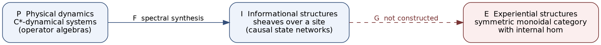
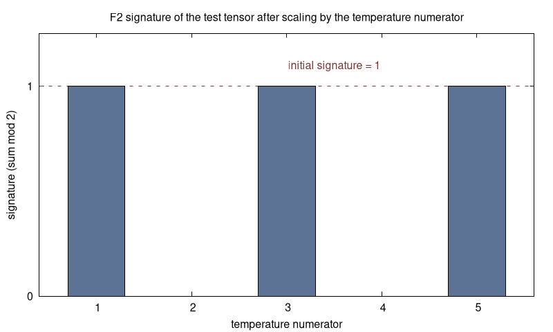

# consciousness-omega

My hand-rolled math kernels for the Consciousness Ω work.

- Array kernels in BQN for integrated information (Φ), entropy, KL divergence, mutual information, F2 cohomology signatures, and finite-field arithmetic.
- Lean 4 and Agda formal statements about the physical, informational and experiential categories.
- A Haskell / Liquid Haskell energy-minimizing projection on Gaussian integers.
- A Klong kernel for the quadratic-extension field.



The F2 parity check: scaling the test tensor by an even temperature numerator flips its signature from 1 to 0, odd numerators keep it at 1.



## Repo map

```
bqn/        array kernels (Φ, entropy/KL/mutual info, F2 telemetry, ant loop, finite field, swarm sweep)
lean/       Lean 4 + Mathlib files
agda/       Agda modules (ant tensor projection, graph invariant, non-reductionist witness)
haskell/    AlgebraicTokenProjection.hs (Liquid Haskell)
klong/      quadratic extension kernel
data/       counterexamples.jsonl
docs/       source-notes.md (the original working log), layout.md, runs.md, toolchains.md, img/
Makefile    one target per language
```

## Run it

Everything goes through the Makefile. Tools are fetched into `tools/`.

| Language | Command | Toolchain |
|---|---|---|
| BQN | `make bqn` | CBQN v0.9.0, built from source |
| Lean 4 | `make lean` | Lean v4.35.0 via elan, Mathlib v4.35.0 |
| Agda | `make agda` | Agda 2.6.4.3 |
| Haskell | `make setup-haskell` then `make haskell` | GHC 9.6.3, cabal 3.10.3.0, Liquid Haskell 0.9.6.3.1, z3 |
| Klong | `make klong` | Klong 20221212 (C), built from source |

`make all` runs every target. Exact versions are in [`docs/toolchains.md`](docs/toolchains.md).

## License

AGPL-3.0-only or the SnapKitty Opaque Source License v1.0, at your choice. The text of the SnapKitty license is in [`LICENSE`](LICENSE), and each source file carries an SPDX header.
