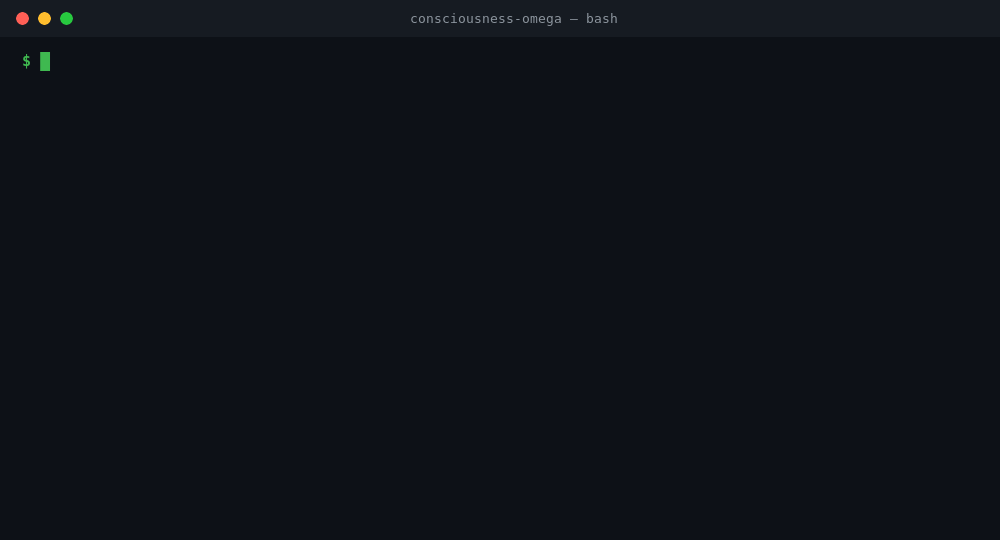
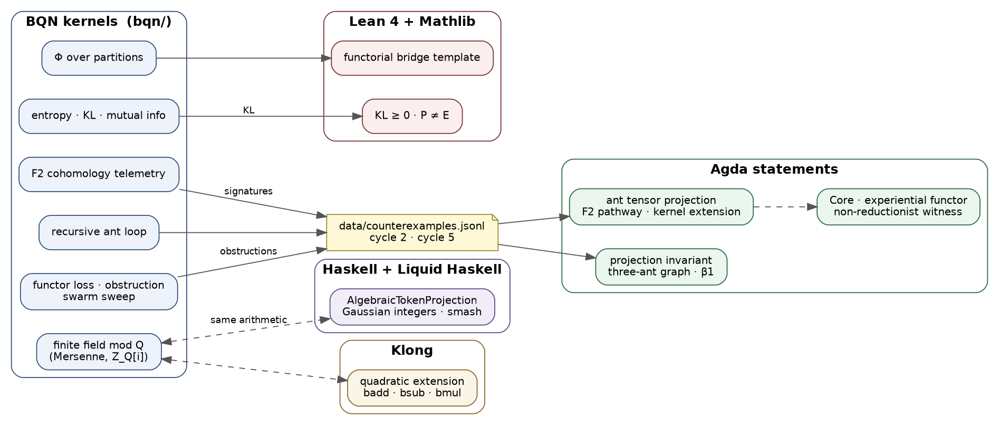
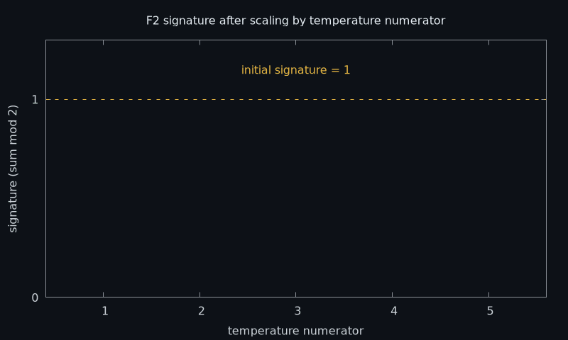

# consciousness-omega

[](LICENSE)
[](https://github.com/dzaima/CBQN/tree/v0.9.0)
[](lean-toolchain)
[](consciousness-omega.agda-lib)
[](consciousness-omega.cabal)
[](https://t3x.org/klong/)
[](https://github.com/AHMADALIPARR/consciousness-omega/commits/main)
[](https://github.com/AHMADALIPARR/consciousness-omega)

My hand-rolled math kernels for the Consciousness Ω work: BQN array kernels for integrated information, entropy, KL, cohomology signatures and finite-field arithmetic, formal statements in Lean 4 and Agda, an energy-minimizing projection in Haskell with Liquid Haskell, and a field kernel in Klong.



*A real session on this repo: entropy, mutual information and KL in BQN, the F2 parity check, and two Agda modules checking.*

## How it works

The idea runs through three categories: physical dynamics **P**, informational structures **I**, and experiential structures **E**. The functor F from P to I is built out of the kernels below. The functor G from I to E is the open part.


Here is how the pieces of the repo feed each other:



### Integrated information Φ
`bqn/phi_integrated_information.bqn` takes a transition matrix for a system, cuts the system into two parts in every possible way, and builds the matrix you would get if the parts did not talk to each other. Φ is the KL divergence between the whole and the best cut, so it measures how much the whole carries beyond its parts.

### Entropy, KL and mutual information
`bqn/entropy_kl_mutual_info.bqn` has the three basic measures in a few lines each. A fair coin has entropy 1 bit (`Entropy 0.5‿0.5` gives `1`). `0.5‿0.5 MutualInfo 0.25‿0.75` gives `0`. The KL divergence from ½,½ to ¼,¾ is `0.20751874963942185`.

### F2 cohomology signature and the even-temperature collapse
`bqn/f2_cohomology_telemetry.bqn` scales a test tensor by a temperature numerator and reads its signature as the sum mod 2. The starting signature is 1. Odd numerators keep it, even ones wipe it to 0, so the run prints `⟨ 1 0 1 0 1 ⟩` for numerators 1 to 5. That collapse is the cycle 2 counterexample.




### Finite fields and Gaussian integers mod Q
`bqn/finite_field_mersenne.bqn` does add, subtract and multiply in the quadratic extension of the field mod the Mersenne prime 2147483647, plus a `Smash` step. `bqn/finite_field_z_q_extension.bqn` does the same for Z_Q[i] with Q = 2462. Everything is exact integer arithmetic, no floats.

### The ant traversal
`bqn/recursive_ant_telemetry.bqn` sends an ant across a 3-D tensor. At each step it slices the local geometry, measures how strongly its embedding resonates with it, and checks the mutual information between the two for an obstruction. The torus bound 89/2462 caps phase leakage. `bqn/functor_loss_swarm.bqn`, `bqn/obstruction_extraction.bqn` and `bqn/swarm_sweep.bqn` run that over a whole swarm and pull out the obstructions.

### Agda statements
The Agda modules state what the kernels should satisfy. `AntProjectionInvariant` builds a three-ant graph, counts its cycles (β1) and records the counterexample. `AntTensorProjectionProof` holds the tensor projection proof. The two `AntTensorProjection` versions state the projection invariant over F2, `RecursiveAntTensorProjection/Core` sets up the algebra, and `ExperientialFunctorCore` and `NonReductionistWitness` build the non-reductionist witness on top of it.

### Lean statements
`lean/ConsciousnessFormalization.lean` states that KL divergence is never negative and that P and E are not equivalent. `lean/FunctorialBridgeTemplate.lean` lays out the bridge: a physical system, its information structure, and the experiential mapping.

### Haskell smash projection
`haskell/AlgebraicTokenProjection.hs` turns token symbols into Gaussian integers, folds them into one state, and keeps halving the embedding until it reaches zero, the latch point. The Liquid Haskell refinements state that the coordinates stay non-negative and that each step shrinks them. The second half adds multiplication of Gaussian integers mod Q.

### Klong kernel
`klong/quadratic_extension.kg` is the same quadratic-extension arithmetic (`badd`, `bsub`, `bmul` over Z_Q[X]/(X² − d)) written in Klong.

### Counterexample records
`data/counterexamples.jsonl` keeps one JSON line per finding. Cycle 2 is the F2 scalar collapse: tensor `[3, 3, 3]`, temperature numerator 2. Cycle 5 is the non-reductionist mapping result with torus ratio 0.036149.

## Run it

Everything goes through the Makefile. Tools are fetched into `tools/`.

```sh
make bqn            # build CBQN v0.9.0 and run every file in bqn/
make lean           # lake exe cache get && lake build
make agda           # check every module in agda/
make setup-haskell  # ghcup: GHC 9.6.3 and cabal 3.10.3.0
make haskell        # cabal build with the Liquid Haskell plugin (z3 on PATH)
make klong          # build Klong 20221212 and load klong/quadratic_extension.kg
make all            # all of the above
```

To poke at a kernel by hand, open the BQN REPL and load the file:

```
$ tools/CBQN/BQN
   )ex bqn/entropy_kl_mutual_info.bqn
   Entropy 0.5‿0.5
1
```

The figures and GIFs rebuild with `docs/img/live-run.sh`, `docs/img/f2_parity_anim.sh`, `gnuplot f2_parity.gp` and `dot` on the `.dot` files, all from inside `docs/img`.

## Repo map

```
.
├── bqn/                     Φ, entropy/KL/MI, F2 telemetry, ant loop, finite fields, swarm
├── lean/                    ConsciousnessFormalization, FunctorialBridgeTemplate
├── agda/                    ant tensor projection, projection invariant, Core, witness
│   └── RecursiveAntTensorProjection/Core.agda
├── haskell/                 AlgebraicTokenProjection.hs
├── klong/                   quadratic_extension.kg
├── data/                    counterexamples.jsonl
├── docs/
│   ├── source-notes.md      the original working log
│   ├── layout.md            which block of the log went to which file
│   ├── runs.md              what each tool printed
│   ├── toolchains.md        versions and setup notes
│   └── img/                 figures, GIFs and the scripts that make them
├── Makefile
├── lean-toolchain, lakefile.toml, lake-manifest.json
├── consciousness-omega.agda-lib
├── cabal.project, cabal.project.freeze, consciousness-omega.cabal
└── LICENSE
```

## Toolchains

| Part | Tool | Version |
|---|---|---|
| BQN | CBQN | v0.9.0 (commit `108379f`) |
| Lean | Lean 4 | v4.35.0 |
| Lean | Mathlib | v4.35.0 (commit `56a0058`) |
| Agda | Agda | 2.6.4.3 |
| Haskell | GHC | 9.6.3 |
| Haskell | cabal-install | 3.10.3.0 |
| Haskell | Liquid Haskell | 0.9.6.3.1 |
| Haskell | z3 | 4.12.1 |
| Klong | Klong (C) | 20221212 |

More detail in [`docs/toolchains.md`](docs/toolchains.md).

## License

AGPL-3.0-only or the SnapKitty Opaque Source License v1.0, at your choice. The text of the SnapKitty license is in [`LICENSE`](LICENSE), and each source file carries an SPDX header.
